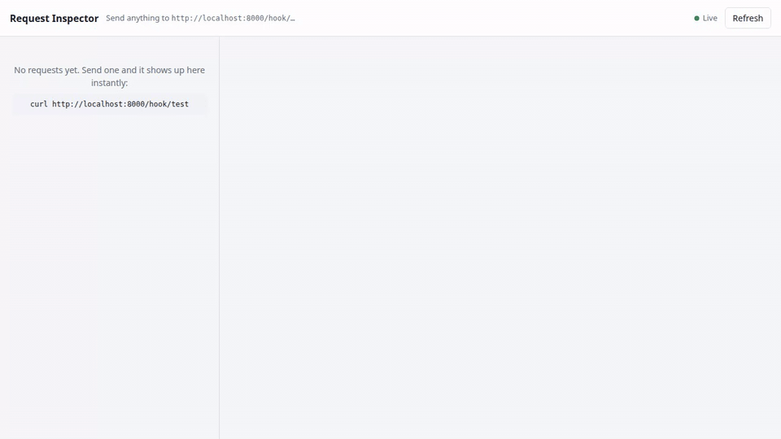
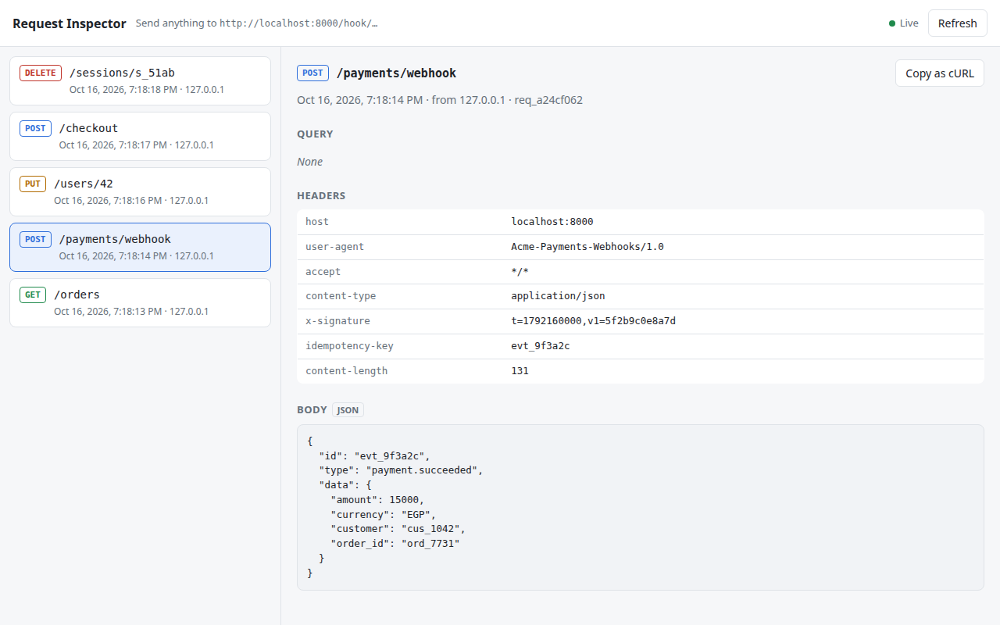

# Webhook Inspector

A small self-hosted tool that catches **any HTTP request** sent to it and shows it **live** in the browser: method, path, query, headers, body, client IP and time. Point a webhook, a mobile app, Postman or `curl` at it, and see exactly what arrived.

**Live instance:** [webhook-inspector-i183.onrender.com](https://webhook-inspector-i183.onrender.com/docs). The link opens the public API docs. The dashboard is token-protected, so the GIF below shows it in action. This runs on Render's free tier, so the first request after a quiet period can take a moment while the server wakes up.



## Features

- **Catch-all endpoint.** `/hook/<anything>` accepts every method (`GET`, `POST`, `PUT`, `PATCH`, `DELETE`, `HEAD`, `OPTIONS`). It records the raw body as sent and keeps repeated query keys (`?tag=a&tag=b`). It also reads the real client IP from behind a reverse proxy.
- **Live dashboard.** New requests are pushed over **Server-Sent Events** and show up in about 40 ms, with no refresh. If the connection drops, the page reconnects and resyncs by itself.
- **Request details.**
  - Headers are shown in a table, and JSON bodies are pretty-printed.
  - Times are stored in UTC and shown in your local timezone.
  - **Copy as cURL** turns the captured request into a ready-to-run `curl` command.
- **Simulate any server behavior.**
  - `?status=429` replies with that status code. `429` and `503` also send `Retry-After`.
  - `?delay=5` waits before replying, so you can see who times out first.
- **Idempotency.** A repeated `Idempotency-Key` gets the original response back with `Idempotent-Replayed: true` and is not recorded twice. A duplicate that arrives while the first request is still running gets `409 Conflict`.
- **Safe to deploy.**
  - The dashboard and API need a token. `/hook/` stays open so anything can send to it.
  - Request bodies are capped at 1 MB and larger ones get `413`. This also works for chunked uploads.
  - CORS allows a named origin, never `*`.
  - The server refuses to start without a token (fail closed).

<picture>
  <source media="(prefers-color-scheme: dark)" srcset="docs/screenshot-dark.png">
  
</picture>

## Tech stack

- **Backend:** Python 3.12 and [FastAPI](https://fastapi.tiangolo.com/), using FastAPI's built-in SSE support.
- **Frontend:** one HTML file with vanilla JavaScript, no build step and no framework.
- **Hosting:** [Render](https://render.com/).

## Run it locally

```bash
git clone https://github.com/ahmed-elembabe/webhook-inspector.git
cd webhook-inspector
python3 -m venv .venv && .venv/bin/pip install -r requirements.txt
echo "INSPECTOR_TOKEN=$(python3 -c 'import secrets; print(secrets.token_urlsafe(24))')" > .env
.venv/bin/fastapi dev app/main.py
```

Open `http://localhost:8000/?token=<your token from .env>`, then send something:

```bash
curl -X POST localhost:8000/hook/payments \
  -H "Content-Type: application/json" \
  -d '{"event": "payment.succeeded", "amount": 150}'
```

## API

| Endpoint | Auth | What it does |
|---|---|---|
| `ANY /hook/{path}` | open | Records the request and replies `{"received": true, "id": ...}` |
| `GET /` | `?token=` | The dashboard |
| `GET /api/requests?limit=50` | `?token=` | The latest captured requests, newest first (up to 200 are kept) |
| `GET /api/stream` | `?token=` | SSE stream with one `request` event per new capture |
| `GET /health` | open | `{"status": "ok"}` |

Query parameters on `/hook/`:

| Parameter | Example | Effect |
|---|---|---|
| `status` | `?status=503` | Reply with this status code (200–599) |
| `delay` | `?delay=3` | Wait this many seconds before replying (0–300) |

## Deploy on Render

| Setting | Value |
|---|---|
| Build command | `pip install -r requirements.txt` |
| Start command | `fastapi run app/main.py --port $PORT --forwarded-allow-ips "*"` |
| Environment | `INSPECTOR_TOKEN` = a long random string |
| Health check path | `/health` |

## Things worth knowing

- **SSE and graceful shutdown.** On shutdown, uvicorn waits for open connections to close, and an SSE stream never closes by itself. Without a fix, every `fastapi dev` reload hung while the dashboard was open. The app wraps `SIGINT` and `SIGTERM` so it ends all streams first. Reloads now take about 1 s.
- **Idempotency races.** The key is reserved *before* the first `await`. Otherwise a retry that arrives during a slow first request would run twice, and that is exactly the double-charge case idempotency exists to prevent.
- **CORS doesn't stop requests.** A cross-origin `text/plain` POST still reaches the server and runs. CORS only hides the response from JavaScript. A JSON POST is different: the browser sends an `OPTIONS` preflight first, and if that fails, the POST is never sent at all.

## Limitations

- **Requests live in memory.** Restarting the server, or Render's free tier going to sleep, clears them.
- **There is one dashboard token per deployment.** This is a personal tool, not a multi-user service.
- **The token goes in the URL**, so it can show up in browser history and server logs.

## Learning notes

The project was built step by step, and each experiment is written up in Arabic in [docs/LEARNING-ar.md](docs/LEARNING-ar.md). The experiments cover:

- How browsers and `curl` react to each status code.
- Who times out first.
- Cookie flags.
- CORS preflights.
