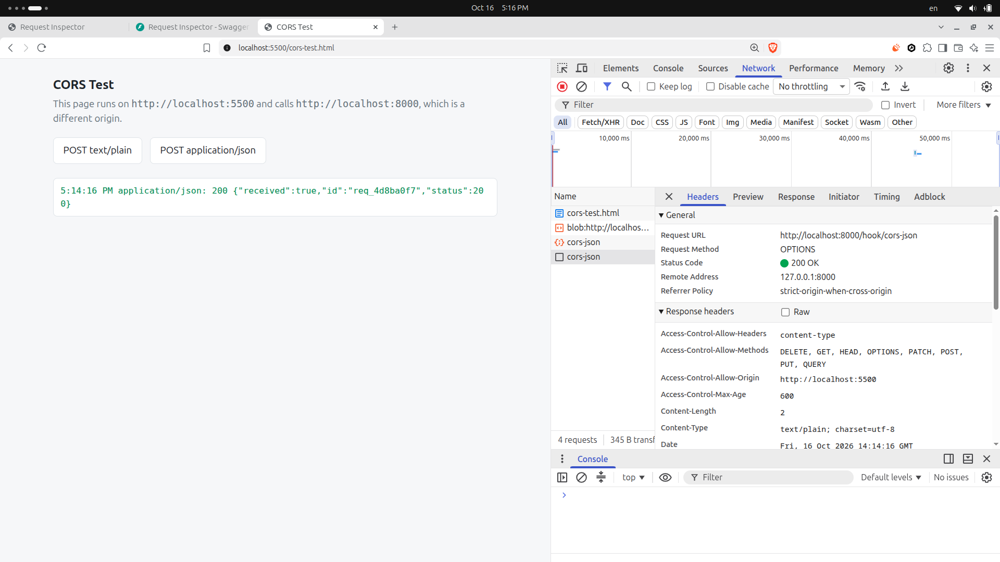

# Request Inspector

أداة صغيرة بتمسك أي طلب HTTP بيوصل تحت `/hook/` وتعرض تفاصيله (method، path، query، headers، body، IP، الوقت) في صفحة ويب.

## التشغيل

```bash
python3 -m venv .venv && .venv/bin/pip install -r requirements.txt
echo "INSPECTOR_TOKEN=$(python3 -c 'import secrets; print(secrets.token_urlsafe(24))')" > .env
.venv/bin/fastapi dev app/main.py
```

- **الصفحة:** `http://localhost:8000/?token=<الـ token اللي في .env>`
- **الـ API docs:**

  ```
  http://localhost:8000/docs
  ```
- **ابعت أي طلب على:** `http://localhost:8000/hook/<أي path>`

## الحماية

| المسار | محتاج `?token=`؟ |
|---|---|
| `/hook/...` | لأ، مفتوح لأي حد عشان أي خدمة تقدر تبعتله |
| `/`، `/api/requests`، `/api/stream` | أيوه، غير كده بيرجع `401` |

- **الـ token مش في الكود:** بيتقري من `INSPECTOR_TOKEN`. محلياً بيبقى في ملف `.env` (متجاهل في git)، وعلى السيرفر بيبقى متغير بيئة.
- **لو مفيش token:** السيرفر **بيرفض يشتغل**، عشان مايطلعش على الإنترنت مفتوح بالغلط.
- **حد الحجم:** أي body أكبر من **1MB** بياخد `413`، ومابيتسجّلش. ده بيشتغل كمان مع الطلبات اللي مافيهاش `Content-Length` (chunked).
- **عيب الـ token في الرابط:** بيظهر في سجل المتصفح، وفي الـ logs بتاعة السيرفر. ده مقبول هنا، بس في نظام حقيقي الأحسن يتبعت في header أو cookie.

## النشر على Render

| الخانة | القيمة |
|---|---|
| Runtime | Python 3 |
| Build Command | `pip install -r requirements.txt` |
| Start Command | `fastapi run app/main.py --port $PORT --forwarded-allow-ips "*"` |
| Health Check Path | `/health` |
| Environment Variable | `INSPECTOR_TOKEN` = token طويل وعشوائي |

`--forwarded-allow-ips "*"` بيخلي الأداة تصدّق الـ `X-Forwarded-For` اللي جاي من الـ proxy بتاع Render، فتسجّل الـ IP الحقيقي للي بعت الطلب، مش الـ IP بتاع الـ proxy. الكلام ده آمن هنا بس، لأن مفيش حد يقدر يوصل للسيرفر غير من خلال Render.

الخطة المجانية بتنيّم السيرفر بعد فترة من غير استخدام. أول طلب بعدها بياخد وقت لحد ما يصحى، وكل الطلبات المتسجلة بتتمسح، لأنها في الذاكرة بس.

## لايف بالـ SSE

الصفحة بتسمع على `GET /api/stream` بـ `EventSource`. أول ما طلب جديد يوصل تحت `/hook/`، الكارت بتاعه بيظهر في الصفحة من غير refresh. في التجربة ظهر بعد حوالي **40 ملّي ثانية** من cURL.

- **المؤشر اللي فوق:** بيقول `Live` لما الاتصال شغال، و`Reconnecting…` لو السيرفر وقع.
- **لما الاتصال يرجع:** الصفحة بتحمّل القائمة كلها تاني، عشان ماتفوّتش طلبات وصلت وهي فاصلة.
- **وقت القفل:** لما السيرفر بيقفل (Ctrl+C، أو الـ reload بتاع `fastapi dev`)، بيقفل الـ streams المفتوحة بنفسه. من غير كده، uvicorn بيفضل مستني الاتصالات تخلص، واتصال الـ SSE مابيخلصش أبداً.

```bash
curl -N localhost:8000/api/stream   # شوف الـ events نفسها في الترمينال
```

## التحكم في رد الأداة

| Query | المعنى |
|---|---|
| `?status=429` | الأداة ترد بالكود ده (من 200 لـ 599) |
| `?delay=3` | تستنى 3 ثواني قبل ما ترد (من 0 لـ 300) |

- مع `429` و `503` الرد بيبقى فيه `Retry-After: 30`.
- `204` و `304` بيرجعوا من غير body، لأن الـ HTTP مايسمحش بـ body معاهم.
- لو القيمة غلط (زي `?status=abc` أو `?status=999`) الأداة ترد `400` ومعاها رسالة توضح الغلط، والطلب نفسه بيتسجّل عادي.
- الطلب بيتسجّل أول ما يوصل، فبيظهر في الصفحة حتى وهو لسه مستني الـ delay.

## Idempotency

لو الطلب فيه header اسمه `Idempotency-Key`:

- **أول مرة يوصل فيها الـ key:** الطلب بيتسجّل عادي، والرد بيتحفظ.
- **لو الـ key ده اتشاف قبل كده:** الأداة بترجّع نفس الرد الأول بالظبط (نفس الـ status والـ body والـ id)، ومعاه `Idempotent-Replayed: true`. الطلب **مابيتسجّلش تاني**، ومابيستناش الـ `delay` تاني.
- **لو الطلب الأول لسه شغال** (مثلاً مستني `delay`) ووصل طلب تاني بنفس الـ key، الأداة بترد `409 Conflict`. ده بيمنع الطلبين إنهم يتنفذوا مع بعض.

```bash
curl -i -X POST localhost:8000/hook/payments -H "Idempotency-Key: pay_123" -d '{"amount":150}'
```

## Cookies

`GET /cookie/set` بيعمل cookie اسمها `demo_session`:

```
set-cookie: demo_session=...; HttpOnly; Path=/; SameSite=lax; Secure
```

| الـ flag | معناه |
|---|---|
| `HttpOnly` | الـ JavaScript مايقدرش يقراها، و`document.cookie` بيرجّع `""` |
| `Secure` | بتتبعت على HTTPS بس (المتصفح بيستثني `localhost`) |
| `SameSite=Lax` | مابتتبعتش مع الطلبات اللي جاية من مواقع تانية، إلا لو المستخدم فتح لينك عادي (GET) |

## CORS

لتشغيل صفحة التجربة على origin مختلف:

```bash
python3 -m http.server 5500 -d cors-test
# افتح http://localhost:5500/cors-test.html
```

### قبل الإصلاح

| الزرار | Console | وصل للسيرفر؟ |
|---|---|---|
| POST `text/plain` | `No 'Access-Control-Allow-Origin' header is present` | **أيوه**، الـ POST وصل ومعاه الـ body |
| POST `application/json` | `Response to preflight request doesn't pass access control check` | **لأ**، اللي وصل `OPTIONS` بس |

- **`text/plain` طلب "بسيط":** المتصفح بيبعته على طول، والسيرفر بيستلمه ويشتغل عليه. الـ CORS بيمنع الـ JavaScript إنه **يقرا الرد** بس، لكن الطلب نفسه اتنفذ.
- **`application/json` طلب "مش بسيط":** المتصفح بيبعت الأول طلب `OPTIONS` (الـ **preflight**) يسأل فيه السيرفر: "مسموح لـ `localhost:5500` يبعت POST بـ `content-type`؟". السيرفر رد من غير headers الـ CORS، فالمتصفح وقف هنا وماعتش الـ POST خالص.

### الإصلاح

```python
app.add_middleware(
    CORSMiddleware,
    allow_origins=["http://localhost:5500"],  # by name, not "*"
    allow_methods=["*"],
    allow_headers=["*"],
)
```

بعده الزرارين بيرجعوا `200`، والـ POST التاني بيوصل. أي origin تاني بياخد `400 Disallowed CORS origin` على الـ preflight.

الـ `OPTIONS` بتاع الـ preflight **مابقاش بيظهر في الأداة**، لأن الـ middleware بيرد عليه بنفسه قبل ما يوصل لـ `/hook/`.

### الـ preflight في تاب Network



ده الطلب والرد بالظبط:

```
OPTIONS /hook/cors-json
Origin: http://localhost:5500
Access-Control-Request-Method: POST
Access-Control-Request-Headers: content-type

HTTP/1.1 200 OK
access-control-allow-origin: http://localhost:5500
access-control-allow-methods: DELETE, GET, HEAD, OPTIONS, PATCH, POST, PUT, QUERY
access-control-allow-headers: content-type
access-control-max-age: 600
```

`access-control-max-age: 600` معناه إن المتصفح بيفتكر الإذن ده 10 دقايق، ومش هيبعت preflight تاني طول المدة دي.

## التجربة: كل status code عمل إيه

اتجربت بـ `curl` وبالمتصفح (Chromium، كتابة الرابط في شريط العنوان).

**200 OK**
cURL طبع الـ JSON وخرج بـ exit code `0`، والمتصفح عرض الـ JSON كنص في الصفحة.

**201 Created**
نفس سلوك الـ 200 بالظبط: cURL والمتصفح الاتنين عرضوا الـ JSON. الفرق بس في معنى الكود، مش في سلوك العميل.

**204 No Content**
cURL ماطبعش أي حاجة وخرج بـ `0`، والمتصفح فضل على الصفحة اللي كان عليها وماغيّرش الـ URL. الـ 204 بيقول للمتصفح "مفيش حاجة جديدة تعرضها".

**400 Bad Request**
cURL عرض الـ body عادي وخرج بـ `0`، ومع `-f` خرج بـ `22`. المتصفح عرض الـ JSON من غير أي صفحة خطأ خاصة بيه.

**401 Unauthorized**
cURL زي الـ 400 (`0`، و`22` مع `-f`). المتصفح عرض الـ JSON ومافتحش نافذة تسجيل دخول، لأن الرد مافيهوش header اسمه `WWW-Authenticate`.

**403 Forbidden**
cURL زي الـ 400 (`0`، و`22` مع `-f`). المتصفح عرض الـ JSON عادي.

**404 Not Found**
cURL زي الـ 400 (`0`، و`22` مع `-f`). المتصفح عرض الـ JSON بتاعنا، مش صفحة "not found" بتاعته، لأن السيرفر بعت body.

**422 Unprocessable Entity**
cURL زي الـ 400 (`0`، و`22` مع `-f`). المتصفح عرض الـ JSON عادي.

**429 Too Many Requests**
cURL عرض `retry-after: 30` مع `-i` وخرج بـ `0` (و`22` مع `-f`)، ومستناش ولا عاد الطلب لوحده. المتصفح كمان عرض الـ JSON بس، وتجاهل الـ `Retry-After`.

**500 Internal Server Error**
cURL زي الـ 400 (`0`، و`22` مع `-f`). المتصفح عرض الـ JSON عادي.

الخلاصة: cURL مابيعتبرش أي status code فشل إلا لو استخدمت `-f`، والمتصفح بيعرض أي body بيرجعله مهما كان الكود. الاستثناء الوحيد هو الـ 204.

## التجربة: `?delay=70`، مين عمل timeout الأول؟

بعتنا 3 طلبات في نفس الوقت: واحد بـ `curl`، وواحد بفتح الرابط في المتصفح، وواحد بـ `fetch` من جوه الصفحة.

| العميل | النتيجة |
|---|---|
| `curl` | `200` بعد 70.0 ثانية |
| المتصفح (فتح الرابط) | `200` بعد 70.1 ثانية |
| `fetch()` في الصفحة | `200` بعد 70.0 ثانية |

**ماحدش عمل timeout.** لا cURL ولا المتصفح ولا uvicorn عندهم مهلة افتراضية للرد أقل من 70 ثانية. cURL بيستنى للأبد إلا لو حددت `--max-time`.

الـ timeout الوحيد اللي ظهر كان من أداة الاختبار نفسها: Playwright بيوقف `page.goto` بعد 30 ثانية افتراضياً، فاضطرينا نقفله. في الحقيقة الـ timeout بييجي من اللي في النص أو من اللي بيبعت الطلب، زي reverse proxy (الـ `proxy_read_timeout` في nginx افتراضياً 60 ثانية) أو بوابة دفع بتبعت webhook وليها مهلة خاصة بيها.
